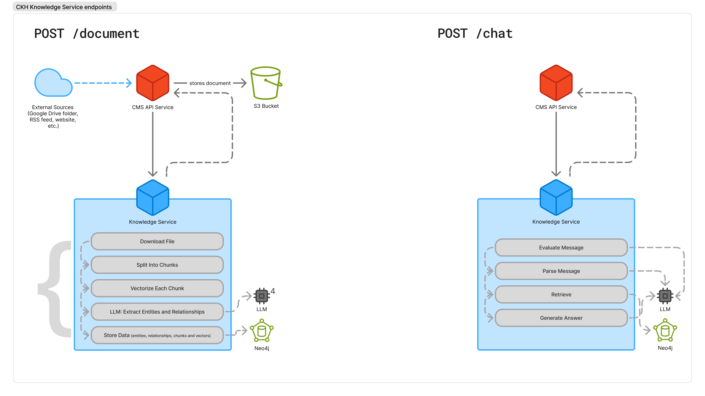
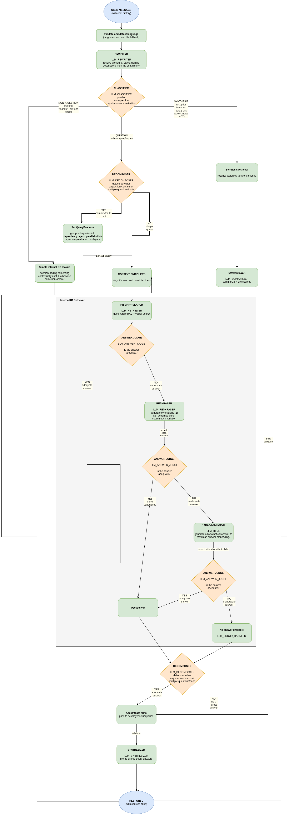

# Suwali: Knowledge Service

This is the Knowledge Service for the Suwali platform. It provides APIs for ingesting new knowledge and for answering questions from the knowledge base.





There are other API endpoints not represented on the diagrams above, but all API endpoints are documented below.

## Running locally for development
You can run this service with or without Docker.
In this README we go through both options.

### 1. Copy environment variables

```bash
cp .env.sample .env
```

### 2.1 Set the Open API key
- Create one from https://platform.openai.com/api-keys,
- Set the key in the `.env` file.

### 2.2 Set the Bedrook API key
- Create an Amazon Bedrock API key in your AWS account.
- Set it as `AWS_BEARER_TOKEN_BEDROCK` in the `.env` file.
- Ensure that you set the following configuration as well:
  - AWS_REGION=eu-west-1
  - BEDROCK_MODEL=eu.amazon.nova-micro-v1:0

### 3.1 Run without Docker, on Mac or Linux

#### Install dependencies

```bash
make install
```

#### Build and run

```bash
make run
```

#### Run linter and unit tests

```bash
run test
```

### 3.2 Build and run with Docker Compose

```bash
docker compose -f docker-compose-development.yml up --build
```

#### Run tests while developing

```bash
$ docker compose -f docker-compose-development.yml exec knowledge pytest
```

### 4. Health Endpoint: make sure everything is running smoothly

```bash
$ curl -s localhost:8000/health/
{"status":"ok"}
```

### 5. Access the knowledge service: perform different actions

**Note:** `hub_id` must be a hub configured in `NEO4J_HUB_CONFIG` in `.env`.

#### Ingest a file

```bash
$ curl -X POST -H 'Content-Type: application/json' -d '{"hub_id":2,"document_id":"RG9jdW1lbnQvMQo=","file_url":"https://silo:9000/documents-dev/file.pdf","text":""}' http://localhost:8000/document/
{"acknowledged":true}
```

#### Ingest text

```bash
$ curl -X POST http://localhost:8000/document/ -H 'Content-Type: application/json' -d '{"hub_id":1,"document_id":"Tm90ZWJvb2svMQo=","file_url":"","text":"Polling stations open at 7am."}'
{
  "id": "95f20c77-e7c1-4bc7-af3b-b9ea5ccf621e",
  "status": "queued"
}
```

##### Extract topics

During ingestion the service extracts up to 5 broad topics for the document (for the topic-subscriptions feature). It can be disabled via the `TOPIC_EXTRACTION_ENABLED` env var. To favour canonical topic names and avoid near-duplicates (e.g. `USA` vs `United States`, `election` vs `elections`), the caller can pass the hub's existing topics in the request; the extractor reuses an existing name verbatim when a detected topic is semantically equivalent.

```bash
$ curl -X POST -H 'Content-Type: application/json' -d '{
  "hub_id": 1,
  "document_id": "RG9jdW1lbnQvMQo=",
  "file_url": "",
  "text": "Long article about the upcoming general election...",
  "existing_topics": ["Elections", "Climate Policy"]
}' http://localhost:8000/document/
```

**Additional ingestion request field:**

| Field             | Type            | Required  | Description                                                                             |
|-------------------|-----------------|-----------|-----------------------------------------------------------------------------------------|
| `existing_topics` | `list[string]`  | No        | The hub's known canonical topics, offered to the extractor for reuse. Defaults to `[]`. |

The extracted topics are returned in the ingestion-completed callback, alongside the `success` flag, in the JSON body:

```
POST {callback_url}
Content-Type: application/json

{"success": true, "topics": ["Elections", "Climate Policy"]}
```

Topic extraction is best-effort: failures never fail the ingestion (the callback is sent with `"topics": []`).


#### Check job status

```bash
$ curl -X 'GET' \
  'http://localhost:8000/document/95f20c77-e7c1-4bc7-af3b-b9ea5ccf621e' \
  -H 'accept: application/json'
{
  "id": "95f20c77-e7c1-4bc7-af3b-b9ea5ccf621e",
  "status": "queued"
}
```

#### Delete Document

```bash
$ curl -X DELETE http://localhost:8000/document/ -H 'Content-Type: application/json' -d '{"hub_id":1,"document_id":"Tm90ZWJvb2svMQo="}'
{"deleted":true}
```

#### Set document topics

Replaces the topics stored on an already-ingested document, without re-ingesting it. The CMS API calls it whenever a document's topic set changes (after it reconciles the topics suggested by ingestion, and when a user adds or removes a topic). `topics` is the full set; send `[]` to clear it. Topics are lowercased and de-duplicated, but not translated, and stored as `(:Document_{hub_id})-[:HAS_TOPIC]->(:Topic_{hub_id} {name})`, with `Topic_{hub_id}.name` unique per hub so retrieval can look topics up by name.

```bash
$ curl -X PUT -H 'Content-Type: application/json' -d '{"hub_id":1,"document_id":"Tm90ZWJvb2svMQo=","topics":["Elections","Saúde Pública"]}' http://localhost:8000/document/topics/
{"updated":true,"error":null}
```

On failure `updated` is `false` and `error` says why: `404` when the document has not been ingested in that hub, `422` for a non-positive `hub_id`, `500` when Neo4j fails. Malformed payloads get FastAPI's standard `422` validation body.

#### Extract topics only (without ingesting)

Extracts topics for a document **without** (re-)ingesting it. This is much cheaper than `/document/` — a single LLM call, with no graph teardown/rebuild. It was added to backfill topics onto documents that were ingested before the topics feature shipped, and can be removed once that one-off backfill is complete.

The endpoint is synchronous and returns the topics directly (no callback). Text is taken from the request `text` field when provided; otherwise it is reconstructed from the document's already-ingested chunks in Neo4j (identified by `document_id`).

```bash
$ curl -X POST -H 'Content-Type: application/json' -d '{
  "hub_id": 1,
  "document_id": "RG9jdW1lbnQvMQo=",
  "existing_topics": ["Elections", "Climate Policy"]
}' http://localhost:8000/topics/
{"topics": ["Elections", "Climate Policy"]}
```

| Field             | Type            | Required | Description                                                                                             |
|-------------------|-----------------|----------|-------------------------------------------------------------------------------------------------------|
| `hub_id`          | `integer`       | Yes      | The hub whose corpus the document belongs to.                                                          |
| `document_id`     | `string`        | No       | Used to read the already-ingested chunk text from Neo4j when `text` is not provided.                   |
| `text`            | `string`        | No       | Optional override; when provided, topics are extracted from this text directly (no Neo4j read).        |
| `existing_topics` | `list[string]`  | No       | The hub's known canonical topics, offered to the extractor for reuse. Defaults to `[]`.                |

Topic extraction is best-effort: LLM failures return `{"topics": []}` rather than an error. If neither `text` nor recoverable chunk text is available, the response is also `{"topics": []}`.

#### Ask a question (synchronous)

When no `callback_url` is provided, the endpoint processes the question synchronously and returns the answer directly:

```bash
$ curl -X POST http://localhost:8000/chat/ -H 'Content-Type: application/json' -d '{"hub_id":1,"message_id":1,"message":"When do polling stations open?","history":[]}'

{
  "answer": "string",
  "metadata": {
    "documents_count": 0,
    "query_tokens": 0,
    "reasoning": "string",
    "rewritten_question": "string"
  }
}
```

#### Ask a question (async with callback)

When a `callback_url` is provided, the endpoint enqueues the question as an RQ job and returns immediately. The answer and intermediary status updates are delivered via callbacks to the provided URL.

```bash
$ curl -X POST -H 'Content-Type: application/json' -d '{
  "hub_id": 1,
  "message_id": 1,
  "message": "To be or not to be?",
  "history": [],
  "callback_url": "https://example.com/api/knowledge-service-callbacks/update-chat-status?message_id=1&token=secret"
}' http://localhost:8000/chat/

{
  "id": "95f20c77-e7c1-4bc7-af3b-b9ea5ccf621e",
  "status": "queued"
}
```

The Knowledge Service will POST status updates to the `callback_url` as the pipeline progresses:

| Status | Description | Payload |
|--------|-------------|---------|
| `parsing_question` | Question rewriting and classification has begun | `null` |
| `searching_sources` | Knowledge graph retrieval has begun | `null` |
| `evaluating_results` | Answer is being evaluated/rephrased (only when retry is needed) | `null` |
| `complete` | Final answer is ready | `{"answer": "...", "metadata": {...}, "error_type": "..." \| null, "topics": [...], "context_updates": [...]}` |
| `error` | Pipeline failed | `null` |

**Callback request format:**

```json
{
  "status": "parsing_question",
  "payload": null
}
```

**Final answer callback (`complete`):**

```json
{
  "status": "complete",
  "payload": {
    "answer": "To be or not to be is a famous philosophical question...",
    "metadata": {
      "documents_count": 3,
      "query_tokens": 1250,
      "reasoning": "The question is self-contained.",
      "rewritten_question": "To be or not to be?"
    },
    "error_type": null,
    "topics": [],
    "context_updates": []
  }
}
```

#### Conversation context

The CMS can send notes about the user, collected earlier in the same conversation, so that answers
take their situation into account. For now the only thing recorded is the user's **location** (city,
region, or country), so a conversation has at most one note:

```json
"conversation_context": [{"id": "42", "text": "Lives in Nairobi, Kenya"}]
```

- Omitted or `null`: the feature is off for this hub. No notes are extracted and `context_updates` is `[]`.
- `[]`: the feature is on and the conversation has no notes yet.
- Note `id`s are opaque strings assigned by the CMS.

The notes are a soft signal for query rewriting and answer generation; the question always wins over a note.
When the feature is on and the conversation has no note yet, a question whose answer depends on where the
user is ("When are the local elections?") is not searched: the reply is a `NO_ANSWER_AVAILABLE` response
explaining that no location was provided, with `metadata.user_location_missing: true`. A question that
names the user's place ("I live in Zagreb, where do I vote?") is searched with the note that same message
produces, so it is never refused. A `question`
resource configured for the unanswerable scenario ("What's your state?") closes that reply. When the user
answers with a location and asks nothing new ("Zagreb", "I live in Zagreb"), the refused question is answered
in that same turn: the CMS marks the refusal in the history it sends (`user_location_missing: true` on that
assistant turn), and the Knowledge Service runs the question before it with the new note instead of the bare
reply, flagging the answer with `metadata.location_question_resumed: true`. The location is still recorded
through `context_updates`. A reply that asks a question of its own is answered as written.
Digest and summary requests ("Catch me up on the local news") are not location-gated yet: without a note
they are summarised across the whole corpus instead of being refused.
While answering, the Knowledge Service also reads the user's message and returns changes to the notes in
`context_updates`, which the CMS applies to its stored notes:

```json
"context_updates": [{"op": "remove", "id": "42"}, {"op": "add", "text": "Lives in Brooklyn, NYC"}]
```

An update is a `remove` plus an `add`. Only a location the user states for themselves is recorded (not a
place they merely ask about), and never at street-address level.
Extraction is best-effort: failures return `[]`, and the `error` callback carries no updates, so the notes stay unchanged.

Intermediary callbacks are fire-and-forget (5s timeout, no retries). The final `complete` callback uses a 30s timeout with 3 retries.

#### Ask a question with personalization

You can customize the chatbot's persona by providing personalization settings in the request. This works with both synchronous and async modes:

```bash
$ curl -X POST -H 'Content-Type: application/json' -d '{
  "hub_id": 1,
  "message_id": 1,
  "message": "What is climate change?",
  "history": [],
  "personalization": {
    "name": "ClimateBot",
    "role": "Environmental Educator",
    "description": "An assistant that explains climate science",
    "tone": "journalist"
  }
}' http://localhost:8000/chat/

{
  "answer": "Climate change refers to long-term shifts in global temperatures and weather patterns...",
  "metadata": {
    "documents_count": 5,
    "query_tokens": 850,
    "reasoning": "The question is clear and self-contained.",
    "rewritten_question": "What is climate change?"
  }
}
```

**Chat request fields:**

| Field | Type | Required | Description |
|-------|------|----------|-------------|
| `hub_id` | `int` | Yes | The hub to query against |
| `message_id` | `int` | Yes | The message ID (used for tracking) |
| `message` | `string` | Yes | The user's question |
| `history` | `list[ChatMessage]` | No | Previous conversation messages for context |
| `personalization` | `object` | No | Chatbot persona settings (see below) |
| `callback_url` | `string` | No | When provided, enables async mode: the question is enqueued as a job and status updates are sent to this URL via POST callbacks |

**Personalization fields:**

| Field | Type | Required | Description |
|-------|------|----------|-------------|
| `name` | `string` | Yes | The chatbot's name (e.g., "ClimateBot") |
| `role` | `string` | Yes | The chatbot's role (e.g., "Environmental Educator") |
| `description` | `string` | No | A brief description of what the chatbot does |
| `tone` | `string` | Yes | The chatbot's tone/persona (see available tones below) |
| `external_resources` | `list[ExternalResource]` | No | External resources the chatbot can reference |

**Available tones:**

| Tone | Description |
|------|-------------|
| `journalist` | Investigative and factual. Presents information using the "who, what, when, where, why" framework. Direct, neutral, and analytical. |
| `advocate` | Warm, calm, and empathetic. Acknowledges emotions and provides supportive responses. Uses gentle phrasing. |
| `executive` | Professional and results-focused. Communicates like a polished executive with structured, business-appropriate language. |

**External resources example:**

```bash
$ curl -X POST -H 'Content-Type: application/json' -d '{
  "hub_id": 1,
  "message_id": 1,
  "message": "How do I get started?",
  "personalization": {
    "name": "HelpBot",
    "role": "Support Assistant",
    "description": "Provides user support and guidance",
    "tone": "advocate",
    "external_resources": [
      {
        "resource_type": "Documentation",
        "title": "User Guide",
        "url": "https://example.com/docs",
        "description": "Complete user documentation"
      },
      {
        "resource_type": "FAQ",
        "title": "Frequently Asked Questions",
        "url": "https://example.com/faq",
        "description": null
      }
    ]
  }
}' http://localhost:8000/chat/
```

When external resources are provided, the chatbot will reference them appropriately in responses, especially when questions are outside the knowledge base or when users ask about capabilities.

#### Summarize texts

```bash
$ curl -X POST -H 'Content-Type: application/json' -d '{"texts":["First text to summarize...","Second text to summarize..."]}' http://localhost:8000/summarize/

{
  "summary": "A concise summary of the provided texts.",
  "metadata": {
    "processing_time_seconds": 1.23,
    "texts_count": 2,
    "total_characters": 150,
    "summary_length": 45
  }
}
```

Instead of `texts`, pass `document_id` + `hub_id` to summarize a document's already-ingested chunks:

```bash
$ curl -X POST -H 'Content-Type: application/json' -d '{"document_id":"doc-123","hub_id":1}' http://localhost:8000/summarize/
```

**Constraints:**
- Maximum 100 texts per request
- Maximum 50,000 total characters across all texts (or ingested chunk text)
- Texts cannot be empty strings

#### Detect the language of a text

Used by the CMS API to welcome a new user in their language. `default_language` and `supported_languages` are optional ISO 639-1 hints for ambiguous texts; `language` is `null` when the text has no clear language (e.g. only emoji or numbers).

```bash
$ curl -X POST -H 'Content-Type: application/json' -d '{"text":"hola, una pregunta","default_language":"en","supported_languages":["en","es"]}' http://localhost:8000/language/

{
  "language": "es"
}
```

### 6. Access other services

#### Swagger: API endpoints
You can try the API endpoints by going to the Swagger UI: http://localhost:8000/docs.

#### Neo4j: Explore graph
You can explore the graph using Neo4j Browser: http://localhost:7474/browser/.

### 7. Chat response metadata

The `/chat/` endpoint returns a `metadata` object with detailed information about the query processing. In synchronous mode, this is in the response body. In async mode, it is delivered in the `complete` callback payload.

| Field | Type | Description |
|-------|------|-------------|
| `documents_count` | `int \| null` | Total number of unique documents used to answer the question |
| `query_tokens` | `int \| null` | Estimated number of tokens in the complete query context (including history) |
| `reasoning` | `str \| null` | Explanation of how the query was rewritten for better retrieval |
| `rewritten_question` | `str \| null` | The reformulated question that was actually used for knowledge graph search |
| `document_ids_used` | `list[str] \| null` | List of document IDs that contributed to the answer |
| `retrieved_chunks` | `list[str] \| null` | Text chunks retrieved from the knowledge graph |
| `entities` | `list[str] \| null` | Named entities extracted and used during retrieval |

**Example successful response:**

```json
{
  "answer": "To be or not to be is a famous philosophical question from Shakespeare's Hamlet...",
  "error_type": null,
  "metadata": {
    "documents_count": 3,
    "query_tokens": 1250,
    "reasoning": "The question is self-contained and clear, no rewriting needed.",
    "rewritten_question": "To be or not to be?",
    "document_ids_used": ["doc_123", "doc_456"],
    "retrieved_chunks": ["Chunk text 1...", "Chunk text 2..."],
    "entities": ["Shakespeare", "Hamlet", "Philosophy"]
  }
}
```

**Note:** The `metadata` field will be `null` when an error occurs (i.e., when `error_type` is set).

### 8. Error handling in chat responses

The `/chat/` endpoint returns structured error information via the `error_type` field in the `ChatResponse`. When an error occurs, the response includes:

- **`error_type`**: One of the predefined error types (enum value)
- **`answer`**: A human-readable error message in the chat language (detected from conversation history)

**Available error types:**

| Error Type | Description | When It Occurs |
|------------|-------------|----------------|
| `QUESTION_TOO_SHORT` | The user's question is too short to understand | Question is less than 8 characters or has fewer than 2 words |
| `QUESTION_TOO_LONG` | The user's question exceeds the maximum length | Question exceeds 1000 characters |
| `SEARCH_ERROR` | An error occurred while searching for relevant information | Neo4j retrieval or graph search fails |
| `CONTEXT_TOO_LARGE` | The retrieved context is too large to process | Token count exceeds 100k limit |
| `LLM_ERROR` | An error occurred while generating the response | OpenAI/Bedrock API call fails |
| `NO_ANSWER_AVAILABLE` | No answer could be found for the question | No relevant information found in knowledge base |
| `INTERNAL_ERROR` | An unexpected internal system error occurred | Unexpected exceptions during processing |

**Example error response:**

```json
{
  "answer": "Your question is too short. Could you provide more details?",
  "error_type": "QUESTION_TOO_SHORT",
  "metadata": null
}
```

**Note:** Error messages in the `answer` field are automatically generated in the user's chat language using an LLM-based translation system. If the LLM translation fails, fallback messages in English are provided.

## Running only linter and unit tests

### 1. Build and run tests with Docker

```bash
docker build -t knowledge .
docker run --rm knowledge bin/run-linter-and-unit-tests-with-coverage.sh
```

## Running integration tests

To run integration tests on CI, add `[knowledge-integration]` to your Git commit message. For instructions on running the tests locally and for additional details, see INTEGRATION_TESTS.md.

## Backup your Neo4j instance

```bash
docker compose -f docker-compose-development.yml run --rm --user=0:0 neo4j bash -lc 'bin/neo4j-admin database dump --to-path=/data/backups neo4j' # Result: /data/backups/neo4j.dump
```
