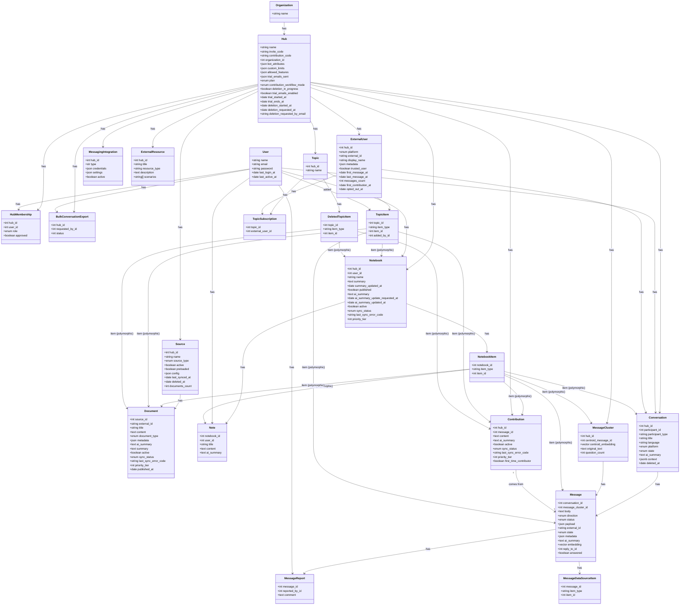

# Data Model

*All classes in this diagram have the attributes id, created_at, and updated_at, but these were omitted for clarity’s sake.*

**User**: A User represents a person with access to the platform, identified by their email and name. Users can be part of many hubs.

**Organization**: An Organization represents a partner entity — such as a civil society organization (CSO), local newsroom, or NGO — that uses the platform to manage one or more community knowledge spaces.

**Hub**: A Hub is a self-contained knowledge environment within the platform, scoped to a specific topic, region, or audience. It's where data sources are connected, community interactions happen, and knowledge is organized. Each Hub belongs to one Organization, but an Organization can have many Hubs. Each Hub references its parent Organization via `organization_id`. A hub can have many users. The `bot_attributes` field stores personalization settings for the bot identity (name, description, tone) that are used when the bot interacts with users.

**Source**: A Source represents an origin or feed of knowledge - not the data itself but where the data comes from. Examples: a Google Drive folder, a website, a WordPress site, a WhatsApp conversation, etc.

**Document**: A Document is an individual piece of knowledge extracted from a source. Examples: a PDF file from a Google Drive folder, a blog post, a relevant WhatsApp message, etc.

**Notebook**: A container that belongs to a hub and groups related notes created by users, and other entities (conversation messages, source documents, etc.) with optional published status. When it's published, its summary is used to feed the knowledge graph.

**Note**: A text-based entry within a notebook, consisting of a title and body, created and timestamped by a user.

**Conversation**: A private 1:1 messaging thread between the system and a participant (typically a `User` for internal conversations, or an external entity for future messaging platforms).

**Message**: A single piece of content exchanged within a `Conversation`, with a direction indicating whether it was incoming from the participant or outgoing from the system.

**Message Data Source Item**: Represents the data source items used by the Knowledge Service for a given message. Data source items can be of type: Document, Contribution and Notebook. *(In the context of the Knowledge service data source items are just called documents)*

**Contribution**: Community knowledge derived from a message sent by a trusted user.

**Bulk Conversation Export**: An export of a hub's latest conversations to a CSV file, requested by a `User` (`requested_by`) and built in the background. A hub has at most one pending export. The file is kept for a few hours; the export stays as an audit trail.

**External User**: Platform-linked contact representing a unique end user from a messaging platform (e.g., WhatsApp, Telegram, SMS or Signal) within a specific hub. For Signal, `external_id` is the user's Signal account UUID, since most users hide their phone number.

**Messaging Integration**: Configuration record that links a hub to a specific external messaging platform (e.g., WhatsApp, Telegram, SMS or Signal), storing the platform type, connection credentials, and activation status.

**Message Report**: A record created by a user (`reported_by`) to report a specific message. It belongs to a `Message` and to a `User`. Only messages with outgoing direction (`bot messages`) can be reported. It may include an optional comment describing the report context.

**External Resource**: A reference to external documentation, guides, or resources that provide additional context for the bot's knowledge. Each external resource belongs to a hub. These resources are included in the bot's personalization context when responding to user queries.

**Message Cluster**: Groups semantically similar messages together using vector embeddings.

**Topic**: A subject of interest within a hub, identified by a name that is unique per hub. Topics are returned by the Knowledge Service when content is ingested or when a chat answer is generated, and they are what end users subscribe to in order to receive notifications about new content.

**Topic Item**: A polymorphic join associating a topic with a piece of content it applies to. The item can be of type Document, Contribution, Notebook (the data source items the topic was found in) or Message (the bot answer the topic was derived from).

**Deleted Topic Item**: Records that a user removed a topic from a data source item, so the Knowledge Service does not add it back when the item is re-ingested.

**Topic Subscription**: An end user's subscription to a topic. It links an `ExternalUser` to a `Topic` (each pair is unique), so the user can be notified when new content arrives for that topic.
